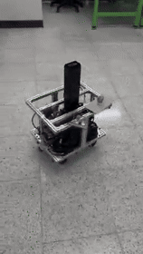

# Capstone — Mobile Manipulator

캡스톤 디자인 모바일 매니퓰레이터 프로젝트 코드베이스임.

- **스워브 베이스** (4륜 독립 조향 + 인휠 구동) + **2단 리프트** + **B601-DM 팔** + 손목/헤드 카메라
- 이 저장소 = 하위 제어(모터 브링업 · CAN 브리지 · 스워브 기구학) + 로봇 모델(URDF/MJCF) + MuJoCo 시뮬 + 텔레옵
- ROS 2 Humble (Ubuntu 22.04). 운용 노드는 C++17, 시험·설정 도구는 Python
- 실기 = 시뮬 같은 토픽: `swerve_controller` 는 실기·시뮬에서 **같은 바이너리·같은 설정 파일**

---

## 사진 및 데모

[](docs/media/base-test.mp4)

[**이동부 시험 전체 영상 보기**](docs/media/base-test.mp4)

개발 중인 모바일 로봇 이동부의 시험 기록입니다. GIF는 원본의 일부를 발췌했으며, 양팔·승강축 협조 작업은 후속 통합 범위입니다.


## 하드웨어

| 항목 | 내용 |
|---|---|
| 구동 | MotorBank BL41105 4" 인휠 BLDC ×4 (Hall, 타이어 Ø105 mm) / Makerbase XDrive V3.6 ×2 (ODrive v3.6 호환, fw 0.5.1) |
| 조향 | RobStride 02 ×4 (7.75:1 내장, 17 Nm 피크, 1회전 절대 엔코더). 출력축 → 베어링 → 조향축 직결 |
| 모듈 배치 | 조향축 x ±91.1 mm, y ±136.05 mm (휠베이스 182.2 / 트랙 272.1 mm). **바퀴가 조향축 바로 아래** (캐스터 오프셋 0) |
| 조향 범위 | 운용 ±180°, 기구 스토퍼·케이블 ±190° |
| 팔 | Seeed reBot Arm B601-DM — 지금 오른팔 1개 (손목 D435i) |
| 리프트 | Flexispot E5 2단 (총 0~650 mm) — BTS7960 + Raspberry Pi Pico |
| 카메라 | 손목 RealSense D435i, 헤드(전방) 카메라 |
| 전원 | VOLTON 24 V 30 Ah 리튬이온 (7S: 만충 29.4 V / 경고 22.5 V / 보드 트립 21 V), 비상정지 · 릴레이 · 퓨즈박스 |
| 컴퓨터 | Jetson AGX 32GB (상위) · Raspberry Pi 5 (하위 제어, CAN) |
| CAN | USB-CAN(candleLight) ×4 — 아래 [CAN 버스](#can-버스) |
| 질량 | 이동로봇 약 23 kg (부품 무게표 합, Jetson·배선 제외) + 팔 |

---

## 시스템 구조

```
 가상 패드 / 게임패드 / (예정) Nav2
              │ cmd_vel (vx, vy, ω)
              ▼
     ┌──────────────────┐   IK → ±180° 접기 → 큰 조향 전환 전 정지 → 조향 속도 제한 → 정렬 게이트
     │ swerve_controller│◀──────────── steer_state (실제 조향각) · wheel_state (실제 바퀴 속도)
     └───┬──────────┬───┘
 steer_cmd│          │wheel_cmd
          ▼          ▼
 ┌─────────────────┐ ┌─────────────────┐        ┌────────────────────────────┐
 │ steer_can_bridge│ │ wheel_can_bridge│  또는   │ mujoco_sim (capstone_sim)  │
 │ RS02 MIT 200 Hz │ │ CANSimple 50 Hz │        │ 두 브리지 + 모터를 대신함   │
 └────────┬────────┘ └────────┬────────┘        └────────────────────────────┘
   can_steer (1 Mbps)   can_drive (500 kbps)
          │                   │
   RobStride 02 ×4      XDrive ×2 → BL41105 ×4
```

리프트 · PC 원격 조작:

```
 PC virtual_pad.py (마우스 · 키보드 · 게임패드)
        │ UDP 5005 (22 B: vx vy ω + 리프트 PWM · 버튼)      ▲ 응답 JSON (robot / lift 상태 → 패드 창 아래 줄)
        ▼                                                   │
 udp_teleop_bridge (라파) ──cmd_vel──▶ swerve_controller (위 그림)
        │ lift_cmd                ▲ lift_state 10 Hz
        ▼                         │
 lift_bridge (라파) ── USB 시리얼 JSON 115200 ──▶ Pico (yor-lift-position-v1) → BTS7960 → Flexispot E5
```

- 명령 입력은 `cmd_vel` 한 지점으로 모임 (패드 · 게임패드 · 이후 Nav2)
- 기구학 코어(`swerve_core`)는 ROS 무관 — C++ 노드·Python(`import swerve_kinematics`)·시뮬이 같은 계산을 씀
- 기구학·정렬 게이트 = KSRC 로버 펌웨어(`swerve_kinematics.c`, `drive_align_gate.c`) C++ 포팅, 같은 테스트 케이스
- 조향 RS02 프로토콜·도구 = idle_ws(B601 팔 제어) MIT 구현에서 가져옴

---

## 저장소 구조

```
capstone_ws/
├── src/                       ROS 2 패키지
├── Wheel_motor/               구동 XDrive 브링업·시험 (USB odrivetool, Python wheel_can)
├── Steer_motor/               조향 RobStride 02 시험·설정 (Python steer_can)
├── Lift/                      리프트 Pico 펌웨어 · 동료 GUI (원본 보관)
└── can/                       CAN 어댑터 이름 고정(udev) + 버스 올리기(can_up.sh)
```

| 패키지 (`src/`) | 이름 | 역할 | 언어 |
|---|---|---|---|
| [description](capstone_ws/src/description/) | `mobile_robot_right_arm_description` | URDF (이동로봇 + 오른팔 + D435i) · 메쉬 · 미리 생성한 MJCF | URDF/MJCF |
| [msgs](capstone_ws/src/msgs/) | `capstone_msgs` | `WheelCommand/State`, `SteerCommand/State`, `LiftCommand/State` | msg |
| [swerve_controller](capstone_ws/src/swerve_controller/) | `swerve_controller` | `cmd_vel` → 조향·구동 명령. 코어 export + Python 바인딩 | C++17 |
| [wheel_can_bridge](capstone_ws/src/wheel_can_bridge/) | `wheel_can_bridge` | XDrive ×2 ↔ ROS (FREE/DRIVE/HOLD, FAULT 래치) | C++17 |
| [steer_can_bridge](capstone_ws/src/steer_can_bridge/) | `steer_can_bridge` | RobStride 02 ×4 ↔ ROS (MIT 위치 제어, 켤 때 각도 확정) | C++17 |
| [sim](capstone_ws/src/sim/) | `capstone_sim` | MuJoCo 시뮬 (브리지 대체) · URDF→MJCF 생성기 · RViz | Python |
| [teleop](capstone_ws/src/teleop/) | `capstone_teleop` | 게임패드(SHAKS S0) · 화면 가상 패드 → `cmd_vel` · `lift_cmd` (PC → 라파 UDP) | Python/YAML |
| [lift_bridge](capstone_ws/src/lift_bridge/) | `lift_bridge` | 리프트 Pico 시리얼 ↔ ROS (조그 · 주차 · 자동 원점) | Python |

| 도구 폴더 | 내용 |
|---|---|
| [Wheel_motor](capstone_ws/Wheel_motor/) | `bringup.py` (USB 설정·점검·저장), `wheel_can/` (vel · monitor · stop · hall_debug …), `COMMANDS.md` |
| [Steer_motor](capstone_ws/Steer_motor/) | `steer_can/` (scan · angle · monitor · active_report · step · enable · zero · param …) |
| [Lift](capstone_ws/Lift/) | Pico 펌웨어 `firmware/main.py`, 동료 GUI `lift_position.py` · `lift_joystick.py`, 문서 `LIFT_POSITION_CONTROL.md` |
| [can](capstone_ws/can/) | `80-capstone-can.rules` (시리얼 → 이름), `can_up.sh` (bitrate·restart-ms·txqueuelen) |

---

## 빌드

```bash
cd ~/capstone/capstone_ws
source /opt/ros/humble/setup.bash
colcon build
source install/setup.bash
colcon test && colcon test-result --verbose      # gtest + Python 테스트
```

- 의존: ROS 2 Humble (`joy`, `teleop_twist_joy`, `robot_state_publisher`, `rviz2`, `xacro`), pybind11, `python-can`
- 시뮬: `mujoco` (pip), `pygame` (가상 패드)
- 구동 USB 도구: `~/odrive_env` (odrive 0.6.x, 보드는 fw 0.5.1)

---

## 빠른 시작

### 시뮬 (하드웨어 없이)
```bash
ros2 launch capstone_sim sim.launch.py                 # MuJoCo + swerve_controller
ros2 run capstone_teleop virtual_pad.py                # 다른 터미널: 가상 패드
ros2 launch capstone_sim sim.launch.py rviz:=true      # + RViz
ros2 launch capstone_sim sim.launch.py teleop:=true    # + 게임패드
```

### 실기
```bash
~/capstone/capstone_ws/can/can_up.sh                   # can_drive 500k / can_steer 1M up

ros2 launch steer_can_bridge steer_can_bridge.launch.py        # 터미널 1
ros2 launch wheel_can_bridge wheel_can_bridge.launch.py        # 터미널 2
ros2 launch swerve_controller swerve_controller.launch.py      # 터미널 3
ros2 run capstone_teleop udp_teleop_bridge.py                  # 터미널 4 (PC 패드 수신)
ros2 run lift_bridge lift_bridge_node.py                       # 터미널 5 (리프트 — launch 말고 run)

# PC (ROS 불필요): 가상 패드 + 노트북에 꽂은 게임패드
python3 capstone_ws/src/teleop/scripts/virtual_pad.py --udp raspberrypi.local --max-lin 0.15 --max-ang 0.5
```

- 터미널별 복사용 명령 · 끄는 순서: [CLI.md 10절](CLI.md)

- 처음엔 **바퀴 띄우고**, 바닥에선 저속(0.15 m/s)부터
- 실기 옆에서 시뮬을 돌릴 땐 `export ROS_DOMAIN_ID=<다른 번호>`

### 조작

PC 패드 창(마우스 · 키보드)과 노트북에 꽂은 게임패드(SHAKS S0)를 같이 읽음. 게임패드는 **RB 누르는 동안만** 동작하고 그동안 마우스보다 우선 (십자키만 RB 없이 됨).

**주행**

| 가상 패드 (마우스 · 키보드) | 게임패드 | 동작 |
|---|---|---|
| 왼쪽 패드 드래그 | RB + 왼쪽 스틱 | 병진 (위 = 전진, 왼쪽 = +y) |
| 오른쪽 패드 좌우 / Q · E (누르는 동안) | RB + 오른쪽 스틱 좌우 | 회전 (왼쪽 · Q = 반시계 +) |
| Space | RB 놓기 | 즉시 정지 (리프트도 정지 · 주차 취소) |
| — | 십자 위 / 아래 | 선속도 상한 ± 0.05 m/s (0.05 .. 0.6) |
| — | 십자 오른쪽 / 왼쪽 | 각속도 상한 ± 0.1 rad/s (0.1 .. 2.0) |
| Esc / 창 닫기 | — | 종료 (0 을 몇 번 보내고 끝) |

- 속도 상한 시작값 = `--max-lin` / `--max-ang`. 스틱 끝 · 패드 끝 = 지금 상한. 십자는 누르고 있으면 반복
- 마우스를 떼거나 창 포커스를 잃으면 0

**리프트** (라파에서 `lift_bridge` 실행 중일 때)

| 가상 패드 (키보드) | 게임패드 (RB 누른 채) | 동작 |
|---|---|---|
| Shift+R / Shift+F (누르는 동안) | Y / A | 빠른 위 / 아래 (PWM 100 %) |
| R / F (누르는 동안) | X / B | 느린 위 / 아래 (PWM 50 %) |
| P | Start | 주차 = 최하단(0 mm)까지 내림 |
| Z 1 초 | Select 1 초 | 지금 위치 = 0 mm (최하단일 때만!) |
| C | LB | Pico 오류 해제 |
| Space | RB 놓기 | 정지 · 주차 취소 |

- 조그는 PWM 0.3 에서 램프로 올림 (2.0 /s). **원점 미등록이면 50 % 까지만** — 이때는 끝단 보호가 없으니 보면서 조작
- 위 · 아래를 같이 누르면 0. 방향을 바꾸면 완전히 멈춘 걸 확인한 뒤 반대로 감 (Pico 는 정지 없이 반대 명령 = fault)
- PWM 바꾸기: `--lift-fast 80 --lift-slow 40`
- 패드 창 아래 `lift: IDLE | h … mm` (원점 미등록이면 노랑 `NOT HOMED`)

---

## 토픽

| 토픽 | 타입 | 방향 |
|---|---|---|
| `cmd_vel` | `geometry_msgs/Twist` | 패드·게임패드 → swerve_controller |
| `steer_cmd` | `capstone_msgs/SteerCommand` | swerve_controller → steer_can_bridge (FREE / POSITION, rad) |
| `wheel_cmd` | `capstone_msgs/WheelCommand` | swerve_controller → wheel_can_bridge (FREE / DRIVE / HOLD, turn/s) |
| `steer_state` | `capstone_msgs/SteerStateArray` | steer_can_bridge → swerve_controller (ready, 실제각) |
| `wheel_state` | `capstone_msgs/WheelStateArray` | wheel_can_bridge → swerve_controller (phase, 속도·Iq) |
| `lift_cmd` | `capstone_msgs/LiftCommand` | udp_teleop_bridge → lift_bridge (jog ±1, duty, stop/park/zero/clear) |
| `lift_state` | `capstone_msgs/LiftState` | lift_bridge → udp_teleop_bridge (높이, 원점 여부, 작업, fault) |
| `joint_states`, `sim/ground_truth` | `sensor_msgs/JointState`, `nav_msgs/Odometry` | 시뮬 → RViz |

서비스: `/swerve_controller/set_free` (SetBool, 전부 FREE 고정), `/wheel_can_bridge/clear_errors`, `/steer_can_bridge/clear_errors` (Trigger)

---

## 규약

- **바퀴 번호**: 위에서 보고 앞오른쪽부터 시계방향 **1 FR, 2 RR, 3 RL, 4 FL** — 조향(RS02 CAN ID) · 구동(XDrive CAN ID) 같은 번호
- **배열 순서**: 항상 `[FR, RR, RL, FL]`
- **좌표** (REP-103): x 전진, y 좌측, ω + = 위에서 보고 반시계
- **조향각**: 0 = 바퀴 전방, + = 위에서 보고 반시계. 영점 = RS02 `zero_sta = 1` 로 저장 (켤 때 −180°~180°)
- **켤 때 각도 확정**: 읽은 값 \|θ\| < 165° 만 확정 (±190° 기구라 접혀 읽힐 수 있음) — 미확정이면 브리지가 enable 안 함
- **구동 속도**: `wheel_cmd` = turn/s, + = 조향각 방향으로 굴러감. 보드 `vel_ramp_rate` 2 turn/s² (= 0.66 m/s²)

---

## CAN 버스

| 이름 | bitrate | 장치 | 점유율 |
|---|---|---|---|
| `can_drive` | 500 kbps | XDrive ×2 (ODrive CANSimple, 표준 ID) | ≈ 16 % |
| `can_steer` | 1 Mbps | RobStride 02 ×4 (확장 ID, MIT 200 Hz) | ≈ 24 % |
| `can_arm_r` / `can_arm_l` | 1 Mbps | B601-DM 오른팔 / 왼팔 | — |

- 어댑터 시리얼로 이름 고정 (udev) — 꽂는 순서와 무관. 자세한 건 [capstone_ws/can/README.md](capstone_ws/can/README.md)
- 버스 올리기는 직접: `can_up.sh` (자동 up 안 함)

---

## 안전

- 한 축 고장 = 전 축 정지 (두 브리지 모두 FAULT 래치 → `clear_errors` 로만 해제)
- Ctrl+C: 구동 브리지 → 전 축 IDLE(자유 회전) / 조향 브리지 → 토크 끔 / swerve_controller → 구동 HOLD + 조향 유지
- **급정지 넘어짐**: 휠베이스가 짧아(182 mm) 앞으로 넘어지는 감속 ≈ 1.5 m/s² (리프트 최저) / 1.05 m/s² (최고). 보드 램프 0.66 m/s² 가 지켜 줌 → **`vel_ramp_rate`·`input_mode` 바꾸지 말 것**
- **큰 조향 전환 전 정지**: 구르는 바퀴가 180° 돌면 차체가 넘어짐 (시뮬 재현) → 컨트롤러가 바퀴를 먼저 세운 뒤 조향
- **XDrive 워치독 아직 꺼짐** — 구동 브리지 프로세스가 비정상 종료하면 보드가 마지막 속도 유지 → 24 V 비상정지를 손 닿는 곳에
- XDrive 보드: **펌웨어 업데이트·재플래시·개조 금지** (설정 변경만)
- **리프트에 리미트 스위치 없음**, 원점은 Pico 를 껐다 켜면 사라짐 → 원점 등록 후에만 소프트 리미트(10 .. 620 mm) 동작
  - `lift_bridge` 를 Ctrl+C 로 끄면 최하단(0 mm)까지 내려 놓고 꺼짐 → 다음에 켤 때 자동 원점 등록 (주차 기록 `~/.local/state/capstone_lift/lift_state.json`)
  - 내려가는 중 Ctrl+C 한 번 더 = 즉시 정지 → 다음엔 수동 원점 (조그로 최하단 → Z 1 초)
  - 끝단에 부딪혀 멈추는 방식으로 원점 잡지 말 것 (동료 문서 규칙)

---

## 진행 상황

- [x] 구동 4축 브링업 (USB 설정·캘리브레이션, CAN ID 1~4, 회전 방향) · C++ 브리지 실기 확인
- [x] 조향 4축: CAN ID · 영점 저장 · 부호(위에서 반시계 = +) 확인 · 가상 패드로 실기 조향 확인
- [x] 스워브 컨트롤러 (IK · 접기 · 정렬 게이트 · 정지 후 조향 · 조향 속도 제한) + 시뮬 검증
- [x] MuJoCo 시뮬 (실제 URDF, 부품 무게 반영) · RViz · 가상 패드 · 게임패드 부호 수정
- [x] CAN 어댑터 이름 고정
- [ ] 구동 + 조향 함께 바닥 주행
- [ ] 조향 램프 가속도 제한 (지금 등속 램프라 저크) · `max_rate` 결정
- [ ] XDrive 워치독 · 브레이크 저항·전압 트립 · 지면 게인 튜닝
- [ ] 오도메트리 노드 (`fk` + 두 상태 토픽) · X-lock 모드
- [x] 리프트 패드 연동: `lift_bridge` (Pico 시리얼), 키보드 · 게임패드 조작, 종료 시 주차 · 켤 때 자동 원점
- [x] 게임패드 십자키로 주행 속도 상한 조절
- [ ] 팔 연동, Pi 5 이식 (arm64 빌드, udev 규칙 설치)

---

## 출처 · 라이선스

- 기구학·정렬 게이트·가상 패드: KSRC 2026 우주로버 코드에서 포팅
- RS02 MIT 도구: idle_ws (B601 팔 제어) 에서 가져옴
- 팔·브래킷 모델: [Seeed reBot-DevArm](https://github.com/Seeed-Projects/reBot-DevArm) — CERN-OHL-W-2.0
- RealSense D435 모델: Apache-2.0
- 고지 원문: `capstone_ws/src/description/licenses/`
