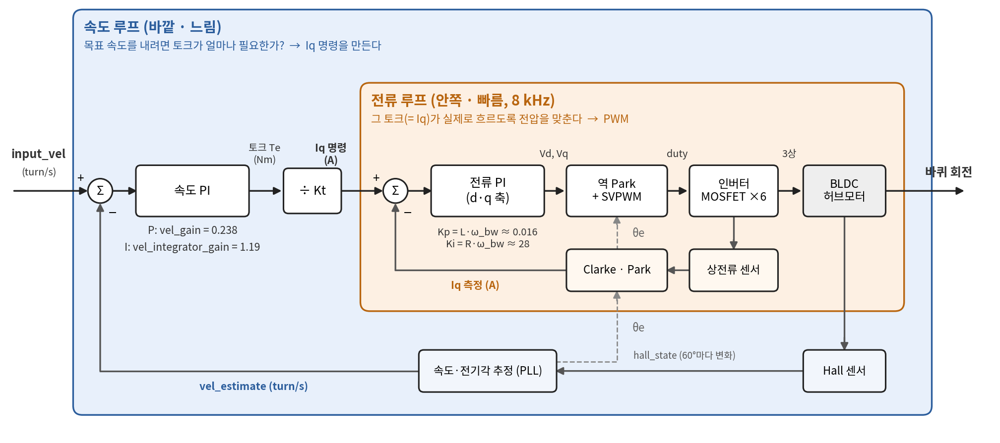

# odrive — 캡스톤 구동부 밑단 제어 (XDrive + BL41105 인휠 모터)

캡스톤 모바일 매니퓰레이터의 스워브 **구동(바퀴)** 쪽 하위 제어입니다.
BL41105 인휠 BLDC 모터 4개를 Makerbase XDrive V3.6(ODrive v3.6 호환, **fw 0.5.1**) 2장으로 구동합니다.
**설정·캘리브레이션은 USB**로 보드에 한 번 저장하고, **운용은 CAN**(CANSimple)으로 합니다.
도구는 odrivetool(설정) → Python `wheel_can`(시험·진단) → C++ `wheel_can_bridge`(ROS2 운용) 3단계 — [아래](#도구-3단계-odrivetool--python--c).

> 보드 펌웨어 업데이트 / 재플래시 / 개조 금지 — 출고 펌웨어 0.5.1 그대로 사용.

## 시스템 구성

```
        (1회, 설정)                                 (매번, 운용)
   PC ── USB-C ──┐                         PC / Pi5 ── USB-CAN(candleLight) ── can_drive (500 kbps)
   bringup.py    │                                                                │
   odrivetool    │                                        ┌───────────────────────┤
                 ▼                                        ▼                       ▼
          ┌─────────────┐   24V 배터리           ┌─────────────┐          ┌─────────────┐
          │  XDrive #1  │◄──────────────────────│  XDrive #1  │          │  XDrive #2  │       
          │ M0    M1    │                        │ id 1  id 2  │          │ id 3  id 4  │
          └──┬─────┬────┘                        └──┬─────┬────┘          └──┬─────┬────┘
             │     │  3상(굵은선) + Hall(5선)        │     │                  │     │
          BL41105 BL41105                        바퀴1  바퀴2              바퀴3  바퀴4
```

## 도구 3단계: odrivetool → Python → C++

같은 보드를 세 층의 도구로 다룹니다. 아래로 갈수록 **사람 손 → 자동 운용**.

| 단계 | 도구 | 연결 | 용도 | 언제 |
|---|---|---|---|---|
| 1. 설정 | `odrivetool`, [bringup.py](bringup.py) | USB | 보드에 **저장되는** 값: Hall/극쌍수, 전류·속도 제한, 게인, R/L·Hall 오프셋 캘리브레이션, CAN ID·속도, (예정) 브레이크 저항·전압 트립·워치독 | 보드/모터/배선이 바뀔 때만 |
| 2. 시험·진단 | [wheel_can/](wheel_can/) (Python, python-can) | CAN | 운용 프로토콜(CANSimple)을 사람이 직접 쳐보는 CLI: `vel`·`monitor`·`stop`·`hall_debug`. **프로토콜 기준 구현** — 공용 테스트 벡터의 원본 | 브링업, 고장 진단, 새 기능 실험 (워치독 등) |
| 3. 운용 | [wheel_can_bridge](../src/wheel_can_bridge/) (C++17, ROS2) | CAN | `wheel_cmd` → 4축, `wheel_state` 발행. 상태기계(FREE/ENTERING/ACTIVE/FAULT)로 안전 처리 | 로봇이 돌 때 항상 (Pi5) |

왜 이렇게 나눴나
- **CAN 으로는 보드 설정 저장이 안 됨** (fw 0.5.1 — 게인·전류제한 변경, `save_configuration` 불가) → 설정은 USB(1단계)에만 있음. 2·3단계는 저장된 설정 위에서 상태 전환·속도 명령·피드백만.
- **Python 으로 먼저 실기 확인 → 같은 동작을 C++ 로 옮김**. 프로토콜은 Python [`lib/cansimple.py`](wheel_can/lib/cansimple.py) 가 기준, C++ [`cansimple.hpp`](../src/wheel_can_bridge/include/wheel_can_bridge/cansimple.hpp) 는 1:1 대응이며 **같은 벡터 파일** [`wheel_can/tests/cansimple_vectors.csv`](wheel_can/tests/cansimple_vectors.csv) 로 둘 다 테스트 → 한쪽만 틀어지면 테스트가 잡음.
- C++ 로 옮긴 이유: ROS2 노드로 상위(스워브 역기구학·내비)와 붙이고, 50 Hz 주기 송신·고장 감지·종료 시 정지를 한 프로세스가 책임지게. Python 도구는 지우지 않고 진단용으로 유지 (참고 구조: [YunBeeeen/idle_ws](https://github.com/YunBeeeen/idle_ws)).

규칙
- **2와 3을 같은 버스에서 동시에 운용 명령 금지.** 브리지 ACTIVE 중 Python 으로 상태를 바꾸면 브리지는 "폐루프 이탈" FAULT 로 전 축 정지 (의도된 동작). `monitor.py` 같은 읽기 전용은 같이 띄워도 됨.
- 1(USB)로 설정을 바꾸면 → 2(`vel.py`)로 실기 확인 → 3(브리지) 순서로.
- 프로토콜을 고칠 땐 벡터 파일 → Python → C++ 순서로, 양쪽 테스트 통과 확인.

## 폴더 구조

| 경로 | 역할 | 연결 |
|------|------|------|
| [bringup.py](bringup.py) | 보드 초기 설정 단계별 도구 (status / check / clear / set-can / set-hall / hall / config / calib / spin) | USB |
| [wheel_can/](wheel_can/) | CAN CLI 도구 (`vel`/`setvel` 속도 명령, `state` 상태 전환, `monitor`·`hall_debug` 디버그, `stop`) + 가상 CAN 테스트 | CAN |
| [COMMANDS.md](COMMANDS.md) | odrivetool 명령 정리, 확정값, 공장 설정 함정, 게인, CAN 대응표, 체크리스트 | — |
| [docs/](docs/) | 속도-전류 캐스케이드 블록도 (`fig_cascade.png/svg`, 생성 스크립트) | — |
| [../capstone_ws/src/wheel_can_bridge](../src/wheel_can_bridge/) | ROS2 C++ 브리지 (운용용, `wheel_cmd` → 4축) | CAN |

## 빠른 시작

### 0. 환경

```bash
source ~/odrive_env/bin/activate      # odrive 0.6.11 (PC 도구) + python-can
```

### 1. 보드 초기 설정 (USB, 보드·모터마다 1회)

24 V 전원 ON + USB-C 연결, odrivetool 은 닫은 상태. 바퀴는 띄우고 축은 브라켓에 고정.

```bash
cd ~/capstone/capstone_ws/Wheel_motor
python bringup.py status --axis 0                          # 현재 설정 확인 (공장 상태인지)
python bringup.py set-hall --axis 0                        # Hall 모드 + 저장 + 재부팅
python bringup.py hall --axis 0                            # 손으로 1바퀴 → hall_state 1~6, 극쌍수
python bringup.py config --axis 0 --pp 10 --kv 41.7        # 설정 + 공장 자동폐루프 해제 + 저장
python bringup.py calib --axis 0 --save                    # R/L + Hall 오프셋 → pre_calibrated 저장
python bringup.py check --board 1                          # 두 축 설정이 기대값과 같은지 OK/!! (읽기만)
```

CAN 번호·속도는 odrivetool 에서 (0.5.1 이름):

```python
odrv0.axis0.config.can_node_id = 1      # axis1 = 2 / 보드 #2 는 3 / 4
odrv0.can.set_baud_rate(500000)
odrv0.save_configuration(); odrv0.reboot()
```

### 2. CAN 활성화

```bash
sudo ip link set can_drive up type can bitrate 500000   # 또는 ../can/can_up.sh (버스 4개 한 번에, 이름 고정은 ../can/README.md)
candump can_drive                             # 021 / 041 (/ 061 / 081) heartbeat 100 ms 주기면 OK
```

### 3. CAN 으로 구동

```bash
cd ~/capstone/capstone_ws/Wheel_motor/wheel_can
python monitor.py                                  # 터미널 A: 상태/에러/속도/Iq/전압
python vel.py --can-id 1 --vel 0.5 --duration 10     # 터미널 B: 10초 → 5바퀴
python stop.py                                     # 비상: 전 노드 속도 0 + IDLE
```

자세한 사용법: [wheel_can/README.md](wheel_can/README.md)

## 제어 구조

ODrive 내부는 속도 PI(바깥) → 전류 PI(안쪽, 8 kHz, FOC) 캐스케이드. 속도 피드백은 Hall + PLL.



| 루프 | 게인 | 값 | 출처 |
|------|------|----|------|
| 속도 P | `vel_gain` | 0.238 Nm/(turn/s) | ODrive 호버보드 가이드 `0.02·Kt·cpr` |
| 속도 I | `vel_integrator_gain` | 1.19 Nm/turn | `0.1·Kt·cpr` |
| 전류 PI | 자동 | Kp = L·ω_bw, Ki = R·ω_bw | 캘리브레이션 R/L, ω_bw = 100 rad/s |

게인은 출발점 — **지면에 내려 하중을 실은 뒤 튜닝** (띄운 상태는 관성이 ~1/27 이라 예민하게 느껴짐).

## 확정값 (보드 #1)

| 항목 | 값 |
|------|----|
| 극쌍수 | 10 (Hall 60카운트/바퀴 + 0.5 turn/s×10 s = 5바퀴로 확인) |
| R / L | M0 0.281 Ω / 157 µH, M1 0.276 Ω / 153 µH |
| Kv / Kt | 41.7 rpm/V / 0.198 Nm/A (사양 역산, 근사) |
| CAN ID (`can_node_id`) | 보드 #1 M0 = 1, M1 = 2 / 보드 #2 M0 = 3, M1 = 4 |
| 바퀴 위치 (= CAN ID) | 위에서 보고 시계방향 **1 FR, 2 RR, 3 RL, 4 FL** → 보드 #1 = 오른쪽, 보드 #2 = 왼쪽. 조향 RobStride 02 도 같은 번호 (2026-11-07) |
| CAN | `can_drive`, 500 kbps, heartbeat 100 ms. 버스 배정: **can_drive 구동 / can_steer 조향 (RS02, 1 Mbps) / can_arm_r 오른팔 / can_arm_l 왼팔** (2026-11-07) |

## 주의 사항

- **XDrive 공장 설정**: 부팅 시 자동 오프셋 캘리브 + 자동 폐루프, 시험용 모터 R/L 이 `pre_calibrated` 로 들어 있음 → 축마다 해제 후 재캘리브레이션 (`bringup.py config` 가 해제 처리).
- **공장 CAN ID(`can_node_id`)는 axis0 = 16, axis1 = 1** → 보드 2장을 같은 버스에 물리기 전에 반드시 변경.
- **DFU/RUN 스위치는 RUN 고정.** CAN 종단 스위치 ON (CANH–CANL 약 60 Ω).
- 상선 순서(파랑 A / 노랑 B / 녹색 C)·M0/M1 단자를 바꾸면 Hall 오프셋 무효 → 재캘리브레이션.
- **상선에 점퍼선/와고 금지** — 측정 R 은 단자~권선 전체 합. 점퍼선+와고로 0.65 Ω, 직결 0.18 Ω (2026-11-04, 모터 3). 배선(길이·굵기·커넥터) 바꾸면 state 4 다시 → 저장.
- 설정은 모터가 아니라 **보드**에 저장됨 — 보드를 바꾸면 같은 모터라도 1단계부터 다시.
- fw 0.5.1 CAN 한계: Get_* 은 RTR 폴링, 게인·전류제한 변경/설정 저장 불가 → USB 로.

## 의존성

- Ubuntu 22.04, Python 3.10, venv `~/odrive_env`
- `odrive==0.6.11.post1` (PC 도구, 보드 fw 0.5.1 지원), `python-can>=4`
- SocketCAN 어댑터 (candleLight / gs_usb), `can-utils`
- udev 규칙: ODrive USB 권한 (`91-odrive.rules`)

## 진행 상황

- [x] 보드 #1 두 축: Hall·극쌍수·캘리브레이션·저장, USB 회전
- [x] CAN 링크 (heartbeat, RTR 피드백), CLI 도구
- [x] CAN 회전 시험 — 보드 #1 `vel.py` 실기 성공 (2026-11-04)
- [x] 회전 방향 부호 기록 — 4축 모두 `+` 속도 = 타이어 트레드의 뾰족한 쪽(V 꼭짓점)이 앞으로 굴러감. 네 모터를 모듈에 **같은 방향**으로 달면 부호 보정 없이 전부 +1 (2026-11-05)
- [ ] 워치독, 배터리 저전압 트립, 설정 백업
- [x] 보드 #2: 공장 자동동작 해제, 500k 저장 (모터 연결 전)
- [x] CAN ID 1~4 로 재지정 (보드 #1 = 1/2, 보드 #2 = 3/4) — USB
- [x] 보드 #2 모터 공통값 + 캘리브레이션 + CAN 회전
- [x] 한 버스(JST 허브, 종단 60 Ω)로 4축 동시 구동 — `vel.py --can-id 1 2 3 4` (2026-11-05)
- [x] ROS2 C++ 브리지 `capstone_ws/src/wheel_can_bridge` + `capstone_msgs` — 빌드·단위테스트 18개 통과 (2026-11-05)
- [x] 브리지 실기 시험 (2026-11-05): 4축 DRIVE 회전, 명령 끊김 → HOLD(손으로 돌려도 버팀), 브리지 Ctrl+C → 전 축 IDLE. CAN 선 뽑기 시험은 워치독 켠 뒤로
- [x] 스워브 기구학 `capstone_ws/src/swerve_controller` (ksrc IK 포팅): `cmd_vel` → `wheel_cmd` + `steer_cmd`, ±170° 접기·정렬 게이트, 단위테스트 22개 + 토픽 시험 (2026-11-07). 조향 브리지·오도메트리는 아직
- [ ] 워치독, 지면 게인 튜닝

띄운 상태 Iq 기준값 (2026-11-05, 4축 동시 vel.py, 일정 속도 = 마찰 토크): id1 0.22 / id2 0.23 / id3 0.34 / **id4 0.54 A**.
id4 는 브라켓에서 빼도 뻑뻑 — 모터 내부 마찰(베어링/실 추정, 속도 올려도 약 2배). 그대로 사용, 지면 시험에서 발열·Iq 차이 추적.

로봇 조립 후 순서: **최종 배선 → 바퀴 띄우고 4축 캘리브레이션(state 4 → 7 → 저장) + `bringup.py check` 로 R 4개 비교 → 회전 방향 기록 → 워치독 → 지면에 내려 속도 게인 튜닝.**
(캘리브레이션 = 모터·배선 성질 → 띄워서, 배선 바뀔 때만 / 게인 튜닝 = 하중 관성에 맞춤 → 지면에서)

전체 체크리스트: [COMMANDS.md §7](COMMANDS.md)
