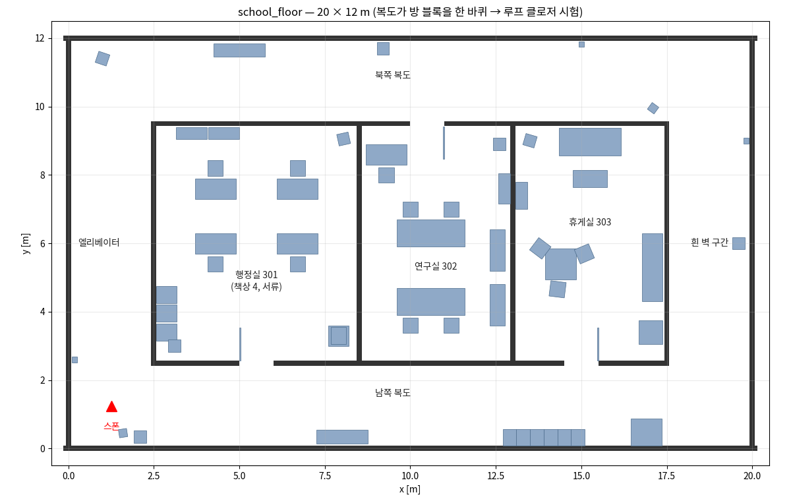
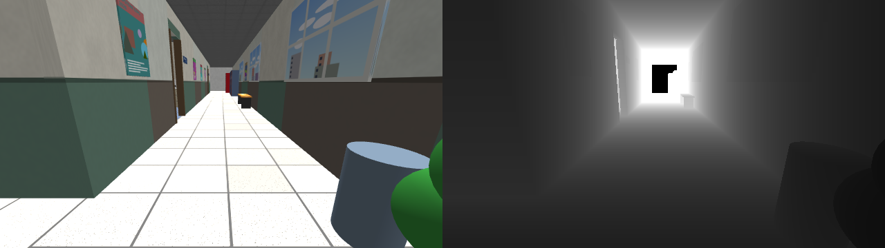
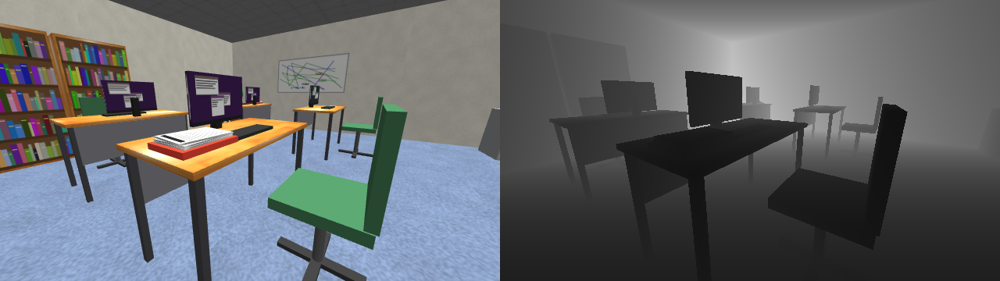
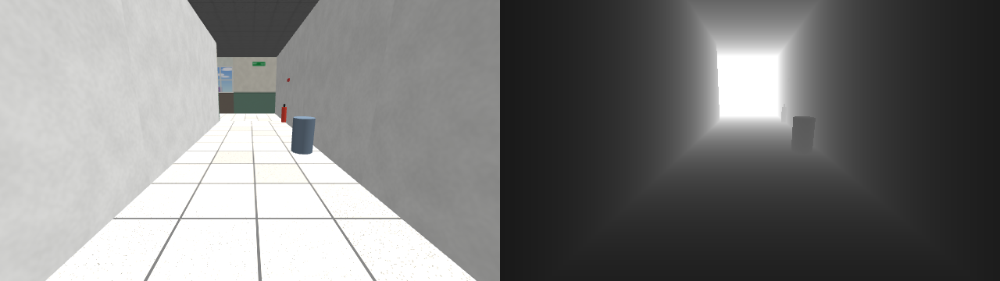
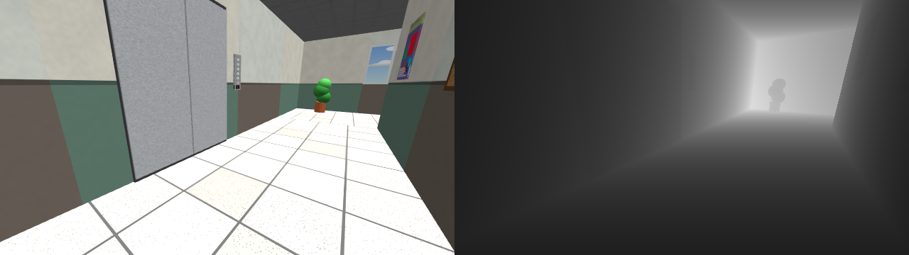

# capstone_gazebo — Gazebo Classic 월드 (VSLAM / Nav2 시험용)

학교 건물 한 층 `school_floor` (20 × 12 m) + ZED 2i 흉내 센서 매크로.
**목적: 카메라 → RTAB-Map → 지도 → Nav2 파이프라인**을 실기(ZED) 전에 맞춰 두기.
스워브 바퀴 물리·odom 은 [`capstone_sim`](../sim/README.md) (MuJoCo) 에서 — 여기선 `planar_move` 로 `cmd_vel` 대로 차체를 바로 움직임.



| 구역 | 내용 | VSLAM 관점 |
|---|---|---|
| 남·북·서쪽 복도 (폭 2.5 m) | 창문(그림 8 장), 포스터 12 장, 게시판, 사물함, 자판기, 엘리베이터, 소화기 | 텍스처 풍부, **전부 다른 그림** (같은 그림이 두 곳에 있으면 잘못된 루프 클로저) |
| 동쪽 복도 | 흰 벽 + 휴지통 하나 | **일부러 어려운 구간** — 실기 흰 벽 복도 흉내 |
| 행정실 301 | 책상 4 (모니터, **서류함 + 서류 2 곳**), 캐비닛, 책장, 프린터, 화이트보드 | 최종 목표 "행정실에서 서류 가져와" 대상 |
| 연구실 302 | 실험대 2, 금속 선반(상자), 책장, 화이트보드 | |
| 휴게실 303 | 소파, 원탁, 냉장고, 조리대(전자레인지·정수기), 책장 | |
| 공통 | 복도가 방 블록을 한 바퀴 돎, 천장 타일, 문짝·호실 명판(한글) | **루프 클로저** 시험 |

| 남쪽 복도 (스폰) | 행정실 책상 (서류) |
|---|---|
|  |  |
| **동쪽 흰 벽 구간** | **서쪽 복도 엘리베이터** |
|  |  |

(왼쪽 RGB, 오른쪽 depth — 시험용 로봇, 카메라 높이 1.0 m, 15° 아래)

## 실행
```bash
cd ~/capstone/capstone_ws && colcon build --packages-select capstone_gazebo && source install/setup.bash
export ROS_DOMAIN_ID=77                                          # 실기 DDS 망과 섞이지 않게

ros2 launch capstone_gazebo world.launch.py                      # 월드 + 시험용 로봇
ros2 run capstone_teleop virtual_pad.py                          # 조종 (다른 터미널) — /cmd_vel
ros2 run rqt_image_view rqt_image_view /zed/zed_node/rgb/image_rect_color

ros2 launch capstone_gazebo world.launch.py gui:=false           # 창 없이
ros2 launch capstone_gazebo world.launch.py robot:=none          # 월드만
ros2 launch capstone_gazebo world.launch.py cam_z:=1.37 cam_pitch:=0.35   # 카메라 높이/기울기 (리프트 최고)
ros2 launch capstone_gazebo world.launch.py x:=10 y:=11 yaw:=3.14         # 스폰 위치
ros2 launch capstone_gazebo world.launch.py robot:=/경로/모델.urdf.xacro    # 다른 로봇
ros2 launch capstone_gazebo world.launch.py odom_tf:=false       # odom TF 끔 — EKF(slam.launch) 가 낼 때 ← SLAM 시험은 이걸로
ros2 launch capstone_gazebo world.launch.py odom_noise:=false vio:=false  # 완벽한 odom, 가짜 VIO 없음
```

## SLAM 시험 (EKF + RTAB-Map, `capstone_navigation`)
```bash
ros2 launch capstone_gazebo world.launch.py odom_tf:=false
ros2 launch capstone_navigation slam.launch.py use_sim_time:=true new_map:=true
# 자동: 복도 루프 61 m 주행 + 참값 비교 (약 6 분)
src/gazebo/tools/run_slam_loop.sh /tmp/slam_run1
```
**시뮬 수치는 "연결되고 동작한다" 확인용** — 가짜 odom·VIO 는 참값에서 만든 것이라 실제 성능 근거가 아님. 실기 판단은 ZED 녹화본으로.
2026-11-11 메모 (각 1 회, 반복성 미확인): RTAB-Map 시각 odometry 단독은 사물함·흰 벽 구간에서 끊김.
가짜 바퀴 odom 만 + RTAB-Map 은 3 회 중 2 회 북↔남 복도를 같은 곳으로 착각(잘못된 루프 클로저).
EKF(바퀴 + 자이로 [+ 가짜 VIO]) + 루프 클로저 검증 강화 + odom 을 TF 로 받기 → 그 1 회에선 지도가 정상.
GUI: 천장은 **레이어 1** — 왼쪽 패널 **Layers** 탭에서 끄면 위에서 내려다볼 수 있음 (카메라 센서엔 항상 보임).
순간이동: `ros2 service call /gazebo/set_entity_state gazebo_msgs/srv/SetEntityState "{state: {name: robot, pose: {position: {x: 10, y: 11}}}}"`

## 토픽 (zed-ros2-wrapper 이름에 맞춤)
| 토픽 | 타입 | 주기 (확인값) |
|---|---|---|
| `/zed/zed_node/rgb/image_rect_color`, `rgb/camera_info` | Image rgb8 640×360 | 15 Hz |
| `/zed/zed_node/depth/depth_registered`, `depth/camera_info` | Image 32FC1 [m], 0.3~15 m | 15 Hz |
| `/zed/zed_node/point_cloud/cloud_registered` | PointCloud2 | 15 Hz |
| `/zed/zed_node/imu/data` | Imu (잡음·바이어스 있음) | ~170 Hz |
| `/odom` + TF `odom → base_footprint` | Odometry — **가짜 바퀴 odom** (`noisy_odom.py`: 참값 + 스케일·회전 오차·잡음). 실기 `swerve_odom` 자리 | 50 Hz |
| `/zed/zed_node/odom` | Odometry — **가짜 ZED VIO** (`fake_vio.py`: 참값 + 작은 드리프트, 특징점 적은 구간에선 ×10). TF 없음. 실기 ZED SDK GEN_3 자리 | 50 Hz |
| `/sim/ground_truth` | Odometry, 참값 (MuJoCo 시뮬과 같은 이름) | 50 Hz |
| `/sim/planar_odom` | planar_move 원본 (잡음 없음, TF 없음) — noisy_odom 입력 | 50 Hz |

프레임: `base_footprint → base_link → zed_camera_link → zed_left_camera_frame → zed_left_camera_optical_frame`, `zed_camera_link → zed_imu_link`.
**ZED 실물 wrapper 버전에 따라 토픽 이름이 다를 수 있음** → ZED 오면 `ros2 topic list` 로 보고 `urdf/sim_sensors.xacro` 의 remapping 만 고칠 것.

## 실제 로봇 모델 붙이기
단순화한 로봇 URDF/xacro 에 매크로 3 줄:
```xml
<xacro:include filename="$(find capstone_gazebo)/urdf/sim_sensors.xacro"/>
<xacro:zed2i_sim parent="front_camera_link" xyz="0 0 0" rpy="0 0.26 0"/>   <!-- 카메라 달 링크, 기울기 -->
<xacro:planar_move_sim base="base_footprint"/>                              <!-- 루트 링크 이름 -->
<xacro:ground_truth_sim body="base_footprint"/>
```
- 바퀴/관절 물리는 필요 없음 (planar_move 가 차체를 직접 움직임). 링크마다 `<xacro:no_gravity link="..."/>` 또는 충돌 형상을 바닥에서 띄울 것
- 루트 링크 이름: 지금 본 URDF 는 `world` — Gazebo 에서 `world` 는 예약어라 **`base_footprint` 로 바꿔야 함**

## 파일
| 파일 | 내용 |
|---|---|
| `tools/make_world.py` | **월드 생성기** — 배치(`build()`), 텍스처(`make_textures()`), 평면도. 고친 뒤 `python3 src/gazebo/tools/make_world.py` |
| `worlds/school_floor.world` | 생성 결과 (직접 고치지 말 것) |
| `models/capstone_materials/` | 생성 텍스처 68 장 + 머티리얼 스크립트 (`model://capstone_materials`) |
| `urdf/sim_sensors.xacro` | 매크로: `zed2i_sim`, `planar_move_sim`, `ground_truth_sim`, `no_gravity` |
| `urdf/test_rig.urdf.xacro` | 임시 시험용 로봇 (박스 + 마스트 + 카메라) |
| `launch/world.launch.py` | gzserver(+gzclient) + robot_state_publisher + spawn + noisy_odom + fake_vio (+ 게임패드) |
| `scripts/noisy_odom.py` | 가짜 바퀴 odom (`/odom` + TF). 파라미터로 오차 크기 조절 |
| `scripts/fake_vio.py` | 가짜 ZED VIO (`/zed/zed_node/odom`). `degraded_zones` 에서 오차 크게 |
| `tools/run_slam_loop.sh`, `slam_loop_run.py`, `slam_eval_db.py` | SLAM 자동 시험: 루프 주행 → 실시간 기록 → DB 최적화 포즈로 최종 지도 오차 |
| `tools/capture_views.py` | 여러 지점 순간이동해서 카메라 RGB/depth 저장 |

## 주의
- 시뮬 VSLAM 은 실제보다 쉬움 (조명 일정, 모션 블러·시간 어긋남 없음). 여기서 되는 건 "파이프라인 연결이 맞다" 까지.
- `/odom` 은 noisy_odom 이 오차를 넣은 값 (planar_move 원본은 잡음 없음 → `/sim/planar_odom`).
- Gazebo Classic 11 은 2025-01 지원 종료 — Humble 에선 잘 돌아서 대회 준비용으론 문제없음.
